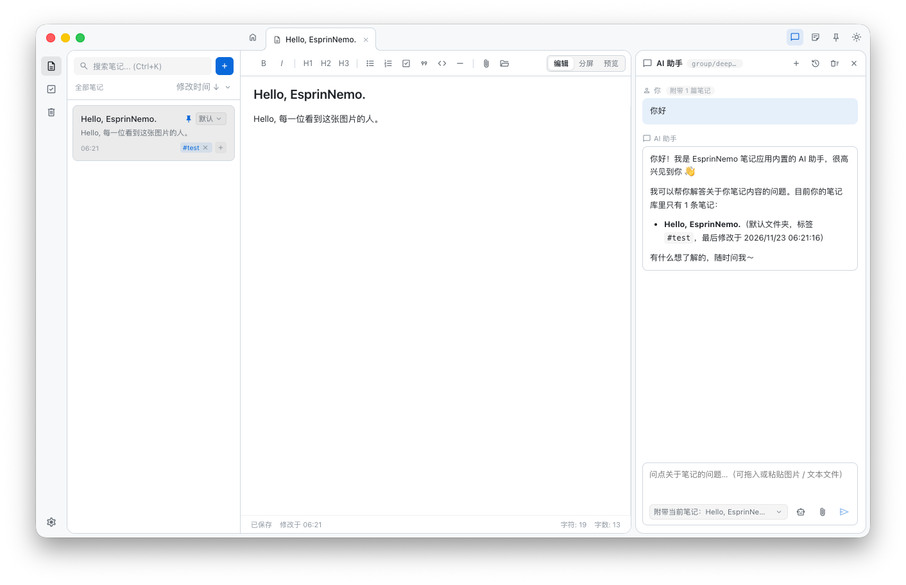

<h1><picture><source media="(prefers-color-scheme: dark)" srcset="assets/tray.svg"><source media="(prefers-color-scheme: light)" srcset="assets/tray.dark.svg"></picture> EsprinNemo</h1>

**Note, Nothing.** 本地优先、离线可用的极简 Markdown 笔记与待办应用。

笔记是普通的 `.md` 文件，标题、文件夹、标签、置顶与废纸篓状态写在文件开头的注释里。不需要账号，没有设置向导，想迁移时复制一个目录就够了。

---

## 平台与下载

| 平台 | 产物 | 说明 |
| --- | --- | --- |
| Windows | `EsprinNemo.Setup.v<版本>.exe` | NSIS 安装包，可选数据目录 |
| Windows | `EsprinNemo.Portable.v<版本>.exe` | 便携版，数据放在程序目录 |
| macOS | `EsprinNemo.v<版本>.dmg` | Universal（Intel + Apple Silicon），拖进「应用程序」安装 |
| Linux | `EsprinNemo.v<版本>.AppImage` | 免安装，`chmod +x` 后运行 |
| Sync | `EsprinSync.v<版本>.exe` / `EsprinSync.v<版本>` | 自建同步服务端（Windows / Linux） |

所有安装包发布在 [GitHub Releases](https://github.com/TheOninesixY/EsprinNemo/releases/latest)。macOS 构建为 ad-hoc 签名，首次打开可能需要在「系统设置 → 隐私与安全性」中允许。

## 功能特性

### 笔记与待办

- 笔记与待办共用一个数据目录、一个废纸篓；待办多一个勾选状态。
- 支持文件夹、标签、置顶、搜索、批量导入 `.md / .markdown / .txt` 与导出 Markdown。
- 附件保存在条目自己的目录里，正文可以插入图片与文件链接。
- 编辑器工具栏覆盖 H1–H6、加粗 / 斜体 / 删除线 / 行内代码 / 链接、无序 / 有序 / 待办列表、引用、代码块、表格与分割线；标题与低频的插入动作用下拉收纳，预览模式下会改正文的控件自动置灰。
- 条目文件是纯 Markdown；`items/<id>.md` 的开头是一段 `<!--EsprinData ... -->` 注释，正文保持干净。
- 废纸篓支持恢复、彻底删除与按保留天数自动清理。

### 界面

- 单套固定布局：左侧笔记列表、中间编辑器，标签栏位于工作区顶部。
- 浏览器式标签：打开多篇、拖动排序、中键关闭，关闭标签不影响文件。
- `Ctrl + K` 即时搜索，标题、正文与标签一起匹配。
- 浅色 / 深色 / 跟随系统，主题色、四档圆角、界面字体与文档字体均可调。
- 设置以独立窗口打开，分类为：编辑器 / 外观 / AI 助手 / 秘密本 / 数据与同步 / 系统 / 关于。
- Windows / Linux 使用自绘窗口按钮；macOS 使用系统原生红绿灯。macOS 的开发者选项里可以临时切回 Windows 样式，切换只作用于本次运行。macOS 主窗口的 ChromeBar 使用系统毛玻璃透出桌面，内容区保持不透明；可在「外观 → 窗口」关闭背景模糊，外框回到纯色表面。
- macOS 默认关闭主窗口后应用继续留在后台；可在「系统 → 运行」关闭后台运行，关闭窗口即退出应用。macOS 的右键菜单与下拉菜单使用系统原生菜单。

<picture>
  <source media="(prefers-color-scheme: dark)" srcset="about/screenshot_dark.png">
  
</picture>

### 小本本

- 从标题栏唤出的置顶小窗口，随手记一句，自动保存。
- 未关联笔记时，保存会在后台新建一篇并关联；已关联时直接写回原笔记。
- `Ctrl + O`（macOS 为 `⌘ + O`）打开笔记选择面板。
- macOS 使用系统原生红绿灯，标题输入区保留在按钮右侧；绿色缩放按钮置灰不可用。
- 关闭主窗口不会退出应用，只要小本本还开着。

<picture>
  <source media="(prefers-color-scheme: dark)" srcset="about/scratchpad_dark.png">
  
</picture>

### 桌面便利贴

- 把笔记或待办贴到桌面：每条内容一张纸，支持预览、编辑、勾选待办、换颜色与关闭移除。
- Windows 上通过 Win32 把窗口压到所有普通窗口之下，并提供桌面右键菜单。
- macOS 上没有可交互的桌面层级 API，便利贴使用窗口层级 `-1` 压到普通窗口之下；按住鼠标时临时抬到普通窗口之上，松开或失焦后回到底层，并固定出现在所有桌面空间。
- Linux 不提供桌面便利贴入口（置底与桌面菜单依赖 Windows 接口）。
- 入口：标题栏图钉、条目右键「贴到桌面」、Windows 托盘菜单或 macOS 菜单栏「文件 → 桌面便利贴」。

### 系统集成

- Windows / Linux：托盘常驻，关窗不退出；可切换托盘图标显隐。
- macOS：不创建托盘图标，相关入口放在屏幕顶部菜单栏；关窗后停留在 Dock。
- macOS 右键菜单使用系统原生菜单（`Menu.popup`），Windows / Linux 保持自绘菜单。
- 三平台均支持开机自启、单实例运行与外部链接用系统浏览器打开。
- 窗口的外观（主题、主题色、圆角、字体）与主窗口保持一致。

### 秘密本

条目可以保存为加密文档，正文使用 AES-256-GCM 加密，密钥由密码派生（PBKDF2-SHA256），只保存在本次运行的进程内。文件本身仍是 `.md`，未解锁时只能看到加密信封。

### AI 助手（可选）

- 兼容 OpenAI 协议的接口：填写 Base URL、API Key 与模型名即可使用。
- 支持普通对话与 Agent 模式。Agent 模式可以调用工具查找笔记、读取正文、新建、修改标题 / 文件夹 / 标签 / 正文、新建文件夹与移入废纸篓（删除前会二次确认）。
- 一条消息最多 6 个附件，可拖入图片或文本文件；单文件读取上限 10 MB。
- API Key 存放在系统密钥链 / 凭据管理器，不写入数据目录，也不回传给渲染进程。

### 自建同步（可选）

- 同步端在自己的机器或服务器上运行，客户端与它通信时才联网。
- 使用操作日志模型：删除是一条明确的 tombstone，不会在多设备之间「复活」。
- 支持手动同步、启动时同步、自动同步、设备 ID、账户登录换令牌与文件日志导入 / 导出。
- 团队笔记（共享）的客户端入口已保留，但当前 JavaScript 版服务端接口返回 `501`，尚不可用。
- 详细步骤见下方[自建同步](#自建同步)。

### 应用更新

- 更新设置位于「设置 → 关于」。
- 默认开启自动检查：启动后检查一次，之后定时复查，发现新版本在后台下载。
- Windows 安装版可静默调用安装包升级；便携版、Linux 与 macOS 打开下载好的文件，由用户自行替换。
- 开发运行不参与自动检查，但仍可手动「检查更新」。

## 快速开始

### 环境要求

- [Bun](https://bun.sh)（安装依赖、运行、打包）
- 打包 macOS 产物需要 macOS；Windows 安装包在 Windows 上构建；Linux AppImage 在 Linux 上构建。

### 安装与运行

```sh
bun install
bun start
```

开发运行时使用项目内的 `data/` 目录，不会影响正式安装的数据。

### 打包

```sh
bun run build:win      # Windows 安装包 + 便携版
bun run build:linux    # Linux AppImage
bun run build:mac      # macOS Universal dmg
bun run build:all      # build + 同步端
bun run build:sync     # 同步端 exe / Linux 可执行文件
bun run build:mobile   # 单文件移动端页面
```

macOS 的 dmg 使用 `build/macos/dmg_background.tiff` 作为安装底图；`bun run build:mac` 会先执行 `build/macos/patch_dmgbuild.js`，修掉 macOS 26 上 dmgbuild 背景 bookmark 损坏的问题。Windows 的 NSIS 自定义页位于 `build/windows/installer.nsh`。最终产物写入 `dist/`；electron-builder 的中间目录与缓存（`builder-debug.yml`、`builder-effective-config.yaml`、`.icon-icns`、`mac-universal` 等）在构建结束后由 `build/move_intermediates.js` 统一移入 `dist/cache/electron_builder/`，自定义构建脚本的缓存写入 `dist/cache/<模块>/`，两者都不会被自动删除。

### 移动端预览

```sh
bun run start:mobile
```

## 数据存储

### 数据目录

| 平台 | 默认数据目录 |
| --- | --- |
| Windows | `%APPDATA%\esprin_nemo\data` |
| macOS | `~/Library/Application Support/esprin_nemo/data` |
| Linux | `~/.local/share/EsprinNemo/data`（跟随 `XDG_DATA_HOME`） |

数据位置记录 `data_path.json` 与同步设备 ID `sync_state.json` 位于配置目录，可在「设置 → 数据与同步」迁移数据目录。便携版把数据、配置与运行时数据都放在程序目录。

### 目录结构

```text
data/
├── items/
│   ├── <id>.md          # 一篇笔记或一项待办
│   └── <id>/            # 该条目的附件
├── shared/
│   └── <owner>/<id>.md  # 共享笔记在本机的投影
├── ai_chats/
│   └── <id>.json        # 一份 AI 对话
├── config.json          # 偏好设置
├── scratchpad.json      # 小本本内容与关联
└── stickies.json        # 桌面便利贴记录
```

### 条目文件格式

```markdown
<!--EsprinData
    type: "note"
    title: "季度复盘"
    folder: "工作"
    tags: ["复盘", "计划"]
    isPinned: false
    isTrashed: false
    createdAt: 1794936683215
    updatedAt: 1794936767664
-->

把这一季的关键决策整理一遍。
```

待办额外带 `isDone`；隐藏、加密与共享状态会按需增加字段。正文始终是普通 Markdown，可以用任意编辑器打开。

## 自建同步

### 启动服务端

```sh
bun run start:sync

bun src/sync/server.js --host 0.0.0.0 --port 8686 --data ./esprin-data
```

默认监听 `127.0.0.1:8686`，数据写入 `./data`，管理后台位于 `/admin`。服务端同时托管移动端网页界面。

### 客户端配置

在「设置 → 数据与同步 → 自建同步」中填写服务器地址，然后使用账户登录或直接填写访问令牌。启动时同步、自动同步与设备 ID 也在同一页配置。令牌保存在系统密钥链。

### 团队笔记

客户端支持共享的接受、拒绝与退出，但当前 JavaScript 版服务端的 `/sync/share*` 接口返回 `501`，共享功能需等待服务端实现。

### 自测

```sh
bun src/sync/server.js --selftest
```

覆盖同步接口、幂等、越界路径、回收 ID、日志整理、管理后台与网页端托管。

## 移动端

`src/mobile/` 是同一套数据格式的触屏界面：

- 列表 / 编辑器 / 设置三块屏幕；手机底部为「笔记 / 待办 / 置顶 / 废纸篓」，平板自动切成双栏。
- 设置分为外观 / 同步 / 数据 / 关于。
- 数据保存在本机 IndexedDB；开启同步后可连自建服务端，按与桌面端相同的文件格式读写。
- `bun run build:mobile` 生成单文件 `dist/EsprinNemo_Mobile_v<版本>.html`，可直接放到任意静态目录。

## 快捷键

macOS 上把 `Ctrl` 换成 `⌘`。

| 按键 | 范围 | 功能 |
| --- | --- | --- |
| `Ctrl + N` | 主窗口 | 新建笔记（草稿标签，写入后才落盘） |
| `Ctrl + Shift + N` | 主窗口 | 新建待办（草稿标签，写入后才落盘） |
| `Ctrl + K` | 主窗口 | 聚焦搜索 |
| `Ctrl + S` | 主窗口 | 保存当前条目 |
| `Ctrl + Tab` | 主窗口 | 切换打开的标签 |
| `Ctrl + S` | 小本本 | 新建并关联，或保存回关联的笔记 |
| `Ctrl + O` | 小本本 | 打开笔记选择面板 |

## 项目结构

```text
├── build/                     # 平台构建资源与脚本
│   ├── macos/                 # ad-hoc 签名、DMG 底图与 dmgbuild 兼容补丁
│   ├── mobile/                # 移动端构建与本地预览
│   ├── sync/                  # 同步端构建
│   ├── windows/               # 应用 ico 与 NSIS 自定义安装页
│   └── move_intermediates.js  # 构建后把中间产物移入 dist/cache
├── scripts/                   # 提交前清理等开发辅助脚本
├── src/
│   ├── desktop/
│   │   ├── main/              # Electron 主进程：窗口、托盘、菜单、同步、更新、便利贴
│   │   └── renderer/          # 主窗口 / 小本本 / 便利贴 / 弹窗与共享样式
│   ├── sync/                  # 自建同步服务端与管理后台
│   └── mobile/                # 移动端网页界面
├── assets/                    # 应用图标（含 macOS icns）、品牌字体与托盘图标
├── about/                     # README 配图
├── DESIGN.md                  # 界面设计系统
├── PRODUCT.md                 # 产品定位与边界
└── LICENSE                    # GPL-3.0
```

## 技术栈

- Electron 44，主进程 + 渲染进程，无前端构建步骤。
- 原生 JavaScript / HTML / CSS，界面基于 CSS 变量。
- Bun 负责依赖、开发运行、打包与同步端编译。
- 同步服务端为 Bun + Node 标准库，管理后台与移动端为静态页面。

## 隐私

- 无账号体系、无遥测、无广告。
- 除用户主动配置的自建同步、AI 助手，以及默认开启的更新检查外，不发起网络请求。
- API Key 与同步令牌存放在系统密钥链 / 凭据管理器，不写入数据目录。

## 已知限制

- **团队笔记**：客户端入口存在，但当前 JS 版服务端未实现共享接口（501）。
- **桌面便利贴**：Linux 不提供；macOS 为普通窗口层级方案，没有桌面右键菜单。
- **界面语言**：目前只有中文。
- **macOS 签名**：dmg 为 ad-hoc 签名，首次打开可能被 Gatekeeper 拦截。
- **更新安装**：仅 Windows 安装版可静默升级；其他平台由用户手动替换。

## 许可与致谢

- 项目代码以 **GPL-3.0** 发布，全文见 [`LICENSE`](LICENSE)。
- 品牌字体 [Mohave](assets/Mohave.ttf) 遵循 SIL Open Font License，授权全文见 `assets/Mohave_OFL.txt`。
- 图标来自 [Lucide](https://lucide.dev)（ISC）。

问题与建议请提交 [Issue](https://github.com/TheOninesixY/EsprinNemo/issues)。
